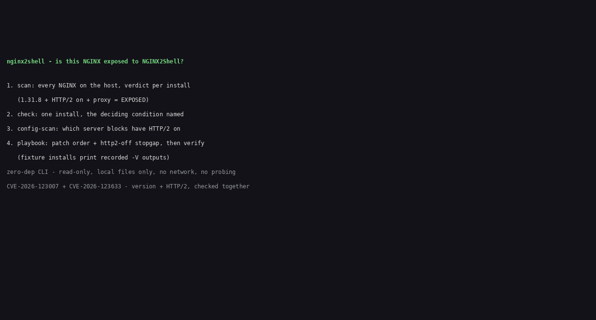

# nginx2shell

Is this NGINX exposed to NGINX2Shell (CVE-2026-123007, CVE-2026-123633)? A zero-dependency CLI that answers from the three live conditions together: NGINX version vs the 18/11/2026 fixed builds, HTTP/2 actually enabled per server block, and operator-supplied exposure context.

## Why

NGINX2Shell is two unauthenticated RCE flaws in NGINX HTTP/2, disclosed 18/11/2026 by Wiz Research, Ikotas Labs, Metnir, Rapid7 and Xint (CVE-2026-123007, CVSS 4.0 9.2 Critical / CVSS 3.1 8.1 High; CVE-2026-123633, same scores). One flaw has been in the code since NGINX 1.9.5 in 2015. Wiz demonstrated unauthenticated RCE with an ASLR bypass on official 1.31.7/1.31.8 builds serving ordinary static files over HTTPS, no backend, no third-party module. Fixed builds shipped the same day: 1.30.7 stable / 1.31.9 mainline.

The flaw is in the proxy, not in the app. Clean app code does not help, and a version-only CVE match calls a host "vulnerable" even when its HTTP/2 is off (HTTP/2 defaults to off, and the module is not built by default). Exposure needs the version and the config together, on the host NGINX runs on:

1. An affected version (CVE-2026-123007: 1.9.5-1.31.8; CVE-2026-123633: 1.19.7-1.31.8).
2. HTTP/2 enabled in at least one server block (`listen ... http2` or `http2 on;`).
3. For CVE-2026-123633, the block also proxies to a backend while free worker connections run low.

`nginx2shell scan` checks all three, per install, with a CI gate. No CVE database, no network, no exploit code. It never probes a port and never runs exploit input.

As of 19/11/2026 there are no reports of exploitation in the wild, and neither CVE is in the CISA KEV catalog. Wiz has not published its exploit code; Rapid7 has published a PoC for CVE-2026-123007 (about 128 GB of HTTP/2 traffic over one connection, and it relies on a specific glibc memory-copy routine chosen on AVX-512 CPUs). Fake nginx2root exploits are circulating on GitHub - do not run exploit code from untrusted repositories. This tool does not claim otherwise.

## Demo



Fixture fleet scan (recorded `nginx -V` outputs) to `check` EXPOSED, `config-scan` review, `playbook`, then the `http2 off;` stopgap to SAFE. The full transcript is in [demo/transcript.txt](demo/transcript.txt).

## Install

Install from source only. The npm package is not published yet.

```sh
git clone https://github.com/techdevfun/nginx2shell.git
cd nginx2shell
npm install
npm run build
node dist/cli.js --help
```

Requires Node 20+ and zero runtime dependencies.

## Quickstart

```sh
# Scan every NGINX on this host (PATH, well-known dirs)
node dist/cli.js scan

# Verdict one install, with the nginx -T dump passed explicitly
node dist/cli.js check /usr/sbin/nginx --config /tmp/nginx-T.txt

# Config only: which server blocks have HTTP/2 on?
node dist/cli.js config-scan /etc/nginx/nginx.conf

# First-hour stopgap
node dist/cli.js playbook
```

## Commands

| Command | What it does | Exit codes |
|---|---|---|
| `scan [--dirs <dir>...] [--config <file-or-dir>] [--internet-facing] [--sockets <file>] [--json]` | Discover NGINX installs and verdict each one | 0 no EXPOSED, 1 >=1 EXPOSED, 2 no NGINX found / usage error |
| `check <nginx-dir-or-binary> [--config <file-or-dir>] [--internet-facing] [--sockets <file>] [--json]` | Verdict a single NGINX install | 0 SAFE, 1 EXPOSED or AT-RISK, 2 UNKNOWN / usage error |
| `config-scan <config-file-or-dir> [--json]` | Per-block HTTP/2, proxy, HTTP/3, resolver, mail report | 0 no HTTP/2 on, 1 HTTP/2 on in >=1 block, 2 usage error / no server block |
| `playbook [--json]` | First-hour stopgap: patch order, http2-off, restart not reload | 0 |
| `explain <topic>` | Background: CVE-2026-123007, CVE-2026-123633, secondary, EXPOSED, AT-RISK, SAFE, UNKNOWN, http2, versions, plus | 0 / 2 unknown topic |
| `init` | Write nginx2shell.config.json for this directory | 0 |

Flags: `--config` parses a config file, config dir, or `nginx -T` dump instead of running `nginx -T` per install. `--internet-facing` records the operator's statement that the host faces the internet (never probed). `--sockets` parses an `ss -tlnp` dump file and lists listening ports as evidence (never probed live).

## Verdict rules

| Verdict | Meaning |
|---|---|
| EXPOSED | Version in the affected range for CVE-2026-123007 AND HTTP/2 on in at least one server block. |
| SAFE | Fixed build (1.30.7 stable / 1.31.9 mainline or later), OR affected version with HTTP/2 off in every block and no secondary signal, OR version below every affected range. |
| AT-RISK | Affected version but HTTP/2 state unknown, OR HTTP/2 off while a secondary signal applies. |
| UNKNOWN | Version unparseable, `nginx -V` failed, or an NGINX Plus build (Plus fixed builds differ per CVE and cannot be mapped from the OSS table). |

The three secondary Critical 9.2 flaws from the same release are reported as signals, never as full audits: CVE-2026-121810 (HTTP/3, 1.25.0-1.31.8, needs an HTTP/3 / QUIC listener), CVE-2026-123634 (DNS resolver, 0.6.18-1.31.8, needs a resolver directive), CVE-2026-113425 (mail proxy, 0.5.33-1.31.8, needs a mail proxy block). Turning HTTP/2 off does not fix them.

## CI gate

```yaml
- run: node dist/cli.js scan --json
# fails the build (exit 1) when any install is EXPOSED
```

## Honest limits

- Trivy/Grype cover the whole dependency tree and every CVE at once; nginx2shell checks exactly the five NGINX2Shell Critical CVEs and nothing else.
- Wiz and other cloud tools see the whole fleet inventory; nginx2shell v0.1.0 scans one host at a time and has no server mode.
- Nuclei checks a remote target over the network; nginx2shell only reads local files and never proves a remote host is exposed. No dedicated Nuclei template for these CVEs was found by search on 19/11/2026.
- Distro builds (`nginx/1.24.0 (Ubuntu)`) parse from the `nginx/X.Y.Z` prefix; confirm distro backports in the vendor advisory.
- NGINX Plus builds are reported UNKNOWN: Plus fixed builds differ per CVE (37.0.7.1 / 37.2.0.1 for CVE-2026-123633, 37.0.8.1 / 37.3.0.1 for CVE-2026-123007). Confirm the Plus build in the F5 advisory.
- CVE-2026-123633 also needs low free worker connections, which is runtime state this tool cannot observe; the error log line "worker_connections are not enough" is the signal to check.
- A name neighbour exists: `jayeshpuri/nginx2shell` (created 19/11/2026, empty, no code) and the Wiz site nginx2shell.com. This repo is the `techdevfun` checker CLI; the npm package `nginx2shell` was unclaimed at build time.
- nginx2shell never proves exploitability. It proves exposure conditions, and says so on every output.

## Roadmap

- v0.2.0: fleet mode (run over SSH inventory, one report per host), distro backport table for Debian/Ubuntu/RHEL packages.
- v0.3.0: `nginx -T` include resolution from the live filesystem when the dump is unavailable.

## License

MIT. See [LICENSE](LICENSE).
